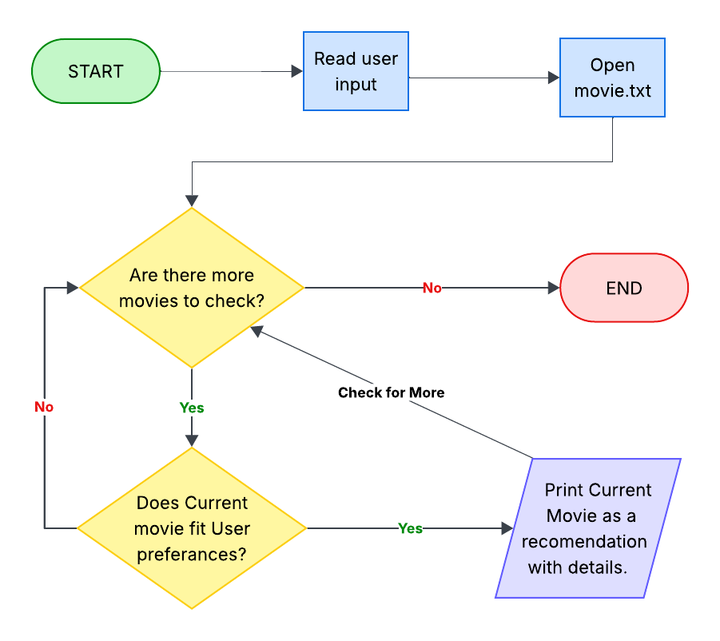

# CS193-Final-Project
Movie Recommendation Program that takes in User Preferences, compares them to a list of movies, and recommends movies that fit the user's inputs. 

## The Problem

Many people spend way too much time trying to find a decent movie to watch instead of just enjoying a movie. This Java program hopes to tackle this problem by taking in user preferences as inputs, comparing them to highly rated movies in its list, and recommending a list of good movies that first match the user's preferences. These preferences include: Genre, Length, and Language. 
* [View my Eisenhower Matrix Planning PDF](OliviaMathew.Eisenhower%20Matrix%20(1).pdf)


## How It Works

* **Reads Inputs:** Reads the user's desired movie lengths, genre, and language directly from the terminal
* **Reads the List:** Opens the "movie.txt" file and checks each movie sequentially. 
* **Checks against the Preferences:** Compares current movie details to the user's preferences.
* **Print or move on:** If the movie fits all 3 criteria, the movie is printed. If the movie does not fit all three, it prints nothing.
* **Repeat:** Moves to the next movie line and does the same thing; stops when it reaches the end of the file. 



## Tech Stack

- **Language:** Java
- **Imports:** 'java.io.File', 'java.io.FileNotFoundException'
- **Version Control:** Git

## Setup

Follow these steps to get the Movie Recommender engine running on your computer locally. 

```bash
git clone (https://github.com/oliviamathew/CS193-Final-Project.git)
cd CS193-Final-Project
```

## Usage

## Example: User wants: medium-length English Horror Movie

```bash
java MovieEngine 120 Horror English
```

**Output**
```text
Showing matching movies:
Obsession - 1 hr 49 mins | English | Horror
```
